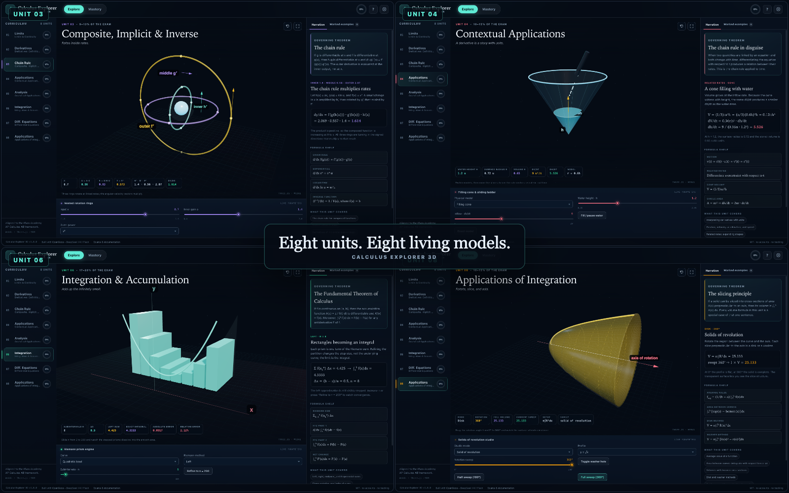

# Calculus Explorer 3D Studio — OpenCode skill

Build a release-grade, static **AP Calculus AB** studio: eight procedural Three.js units, 40 worked examples, 96 questions, adaptive mastery, three verification layers, and GitHub Pages.

This repository is the publishable copy of the skill `calculus-explorer-3d-studio`. It contains the full reference application, the build log, the exact reproduction method, and a scaffold that copies a working project.



- **Live reference product**: <https://somphol.github.io/calculus-explorer-3d/>
- **Reference source**: <https://github.com/somphol/calculus-explorer-3d>
- **Skill ID**: `calculus-explorer-3d-studio`
- **License**: MIT
- **Built with**: OpenCode + DeepSeek V4.1 Flash

## Install

### From this catalog

Add the catalog base URL to your OpenCode config:

```jsonc
{
  "$schema": "https://opencode.ai/config.json",
  "skills": ["https://somphol.github.io/calculus-explorer-3d-skill/"]
}
```

OpenCode reads `index.json`, then fetches each listed file under
`calculus-explorer-3d-studio/`.

### Locally

```sh
git clone https://github.com/somphol/calculus-explorer-3d-skill.git
cp -R calculus-explorer-3d-skill/calculus-explorer-3d-studio ~/.config/opencode/skills/
```

Or point OpenCode at a local skills directory containing the folder.

## Use it

Ask for an eight-unit AP Calculus visualizer, a multi-unit Three.js educational app with adaptive practice, or a release-grade STEM studio. The skill covers:

- the eight Khan Academy AP Calculus AB units and the teaching sequence;
- the visual contract for eight distinct scenes under one renderer;
- 40 examples and a 96-question bank with permanent mastery IDs;
- adaptive mastery in `localStorage`, numeric FRQs, export/import;
- a dependency-free headless Chrome harness with mock keychain;
- release docs, screenshots, Pages, and `state.json`.

## Scaffold a project

```sh
node calculus-explorer-3d-studio/scripts/new-project.mjs --out ~/Projects/my-calculus-studio
cd ~/Projects/my-calculus-studio
python3 -m http.server 8000
```

Prove the scaffold:

```sh
node --test tests/curriculum.test.mjs tests/static.test.mjs   # 33/33
node tests/browser.test.mjs                                   # 47/47
```

The reference ships its build state. Replace `state.json`, the canonical/OG URLs, and the content with your own; do not present the original session as yours.

## Verify the skill itself

```sh
node ~/.config/opencode/skills/skill-publish/scripts/check-skill.mjs ~/.config/opencode/skills/calculus-explorer-3d-studio
node calculus-explorer-3d-studio/scripts/verify-skill.mjs
```

The reference is tested at three layers:

| Gate | Expected |
| --- | --- |
| Core (Node) | 16/16 |
| Static (Node) | 17/17 |
| Browser (headless Chrome) | 47/47 |
| In-page self-test | 27/27 |

## Repository layout

```
index.json                       catalog manifest (content-hashed version)
calculus-explorer-3d-studio/
├── SKILL.md                     model-facing instructions
├── ATTRIBUTION.md               origin, reused work, license status
├── LICENSE
├── assets/reference/            the complete shipped app + tests + docs
├── references/
│   ├── method.md                construction order and invariants
│   ├── content.md               unit/question/exam schemas and accuracy
│   ├── visuals.md               eight scene recipes
│   ├── verification.md          three layers + self-test + harness flags
│   ├── hosting.md               Pages, token/keychain, catalog
│   └── build-log.md             what actually happened, including bugs
└── scripts/
    ├── new-project.mjs          scaffold a fresh project
    └── verify-skill.mjs         prove the reference
docs/preview.png
scripts/sync-index.mjs           rebuild index.json after edits
```

After editing any skill file:

```sh
node scripts/sync-index.mjs
```

The version is a SHA-256 content hash, so clients refresh.

## What is intentionally not here

- No Khan Academy videos, text, exercises, or assets. The unit structure is public; all content is original.
- No College Board questions. AP® is a trademark of the College Board, which does not endorse this project.
- No backend, accounts, analytics, or runtime npm dependencies.
- No credentials or machine-specific secrets. The build log describes the token/keychain method without a token.

## License and attribution

MIT. See [LICENSE](LICENSE) and [ATTRIBUTION.md](ATTRIBUTION.md). Three.js 0.169.0 is MIT and is loaded from a pinned CDN. Screenshots are generated from the app.
