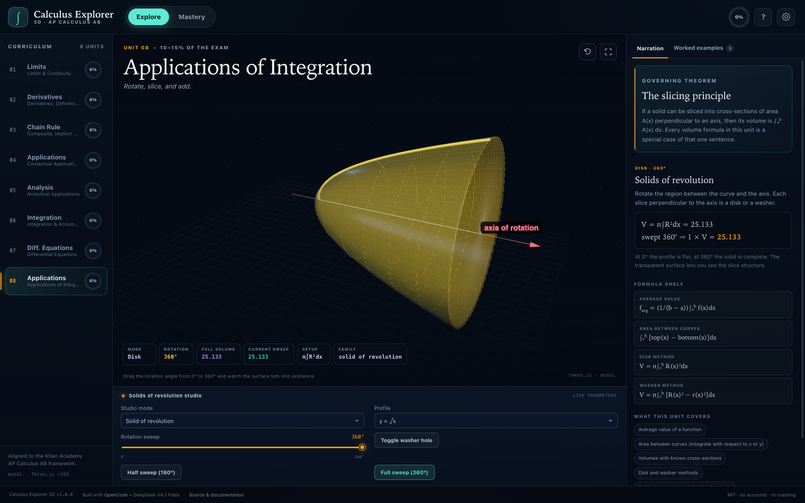
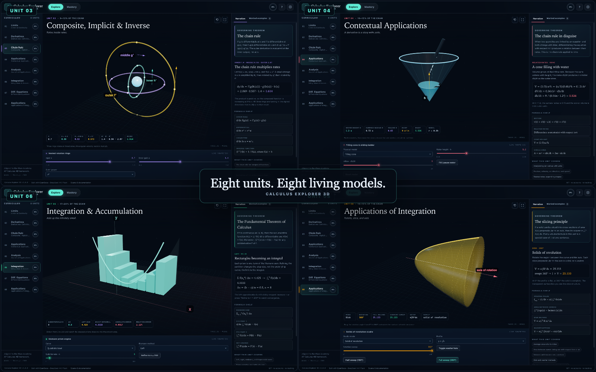
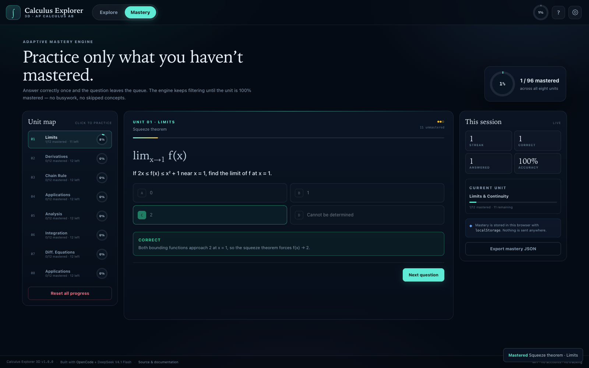
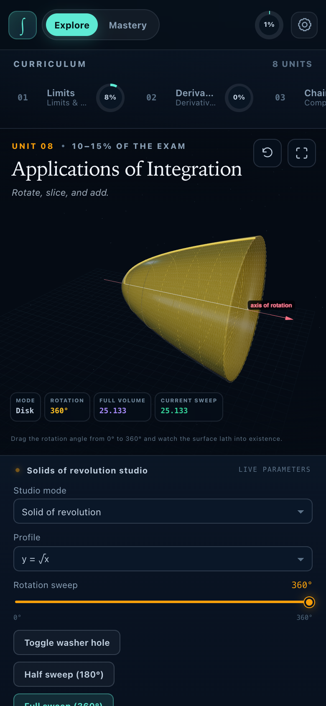

# Calculus Explorer 3D

**AP Calculus AB Interactive Visualizer & Mastery Engine** — eight Khan Academy units translated into eight live WebGL models, 40 worked examples, and a 96-question adaptive mastery bank.

[**Open the live studio →**](https://somphol.github.io/calculus-explorer-3d/)



Calculus Explorer 3D is a static, single-page educational application. There is no backend, no account system, no build step, no package manager, no analytics, and no third-party font. Three.js is pinned at `0.169.0` and loaded through an import map. Mastery lives in the browser's `localStorage`.

---

## What is inside

| Unit | 3D studio | Practice bank |
| --- | --- | --- |
| 01 · Limits & Continuity | Two independent tracers converge on a removable hole, jump, asymptote, or squeezed oscillation | 10 MC + 2 FRQ |
| 02 · Derivatives: Definition & Rules | A glowing tangent cylinder glides along a curve while a secant triangle collapses | 10 MC + 2 FRQ |
| 03 · Composite, Implicit & Inverse | Three nested rings rotate at the inner, middle, and outer derivative rates | 10 MC + 2 FRQ |
| 04 · Contextual Applications | A cone fills with water and a ladder slides down a wall; live rate vectors | 10 MC + 2 FRQ |
| 05 · Analytical Applications | Curvature-coloured terrain, extrema beacons, tangent plane, and an MVT chord | 10 MC + 2 FRQ |
| 06 · Integration & Accumulation | Extruded Riemann prisms morph from n = 2 to n = 200 | 10 MC + 2 FRQ |
| 07 · Differential Equations | A colour-coded slope field with click-to-drop RK4 solution particles | 10 MC + 2 FRQ |
| 08 · Applications of Integration | A partial lathe or disk/washer/cross-section studio, swept from 0° to 360° | 10 MC + 2 FRQ |



Each unit also carries:

- **Five step-by-step worked examples** with a formula, numbered reasoning, a takeaway, and a pointer to the 3D view that makes it visible.
- **A governing theorem card** and a live narration box that rewrites the mathematics as the sliders move.
- **A formula shelf and concept map** aligned to the AP Calculus AB framework.
- **Six live readouts** so the model is legible without reading the graph.

## The mastery engine

- A correct answer marks that question `mastered` and removes it from the adaptive queue.
- A missed question stays in the queue and returns later in the same session.
- Unit mastery is `mastered / 12`; overall mastery is `mastered / 96`.
- When a unit reaches 100%, the queue is empty and the completion card offers a full review pass.
- Mastery is stored under `calc3d.mastery.v1`. It can be exported, imported, or reset from the settings dialog.
- Free-response answers are auto-gradable numeric entries. Fractions, decimals, and simple π multiples are accepted (`32/5`, `20.11`, `2π`).



<p align="center"></p>

## Quick start

No install, no build:

```sh
cd calculus-explorer-3d
python3 -m http.server 8000
# open http://localhost:8000/
```

Any static server works. Opening `index.html` directly with `file://` is not supported because ES modules and the import map require HTTP.

### Verification

```sh
node --test tests/curriculum.test.mjs tests/static.test.mjs
node tests/browser.test.mjs                    # headless Chrome, local server
TEST_URL=https://somphol.github.io/calculus-explorer-3d/ node tests/browser.test.mjs
```

Open `?selftest` to run the built-in 27-check suite in the page.

### Regenerate screenshots

```sh
node scripts/screenshot.mjs
```

The script launches one headless Chrome instance with `--use-mock-keychain`, a throwaway profile, and a local server on an ephemeral port. It never touches the macOS login keychain.

## Architecture at a glance

```
index.html                 shell, import map, dialogs, self-test overlay
style.css                  dark scientific design system + responsive layout
src/main.js                controller: routing, controls, narration, mastery UI
src/data/curriculum.js     all 8 units, 40 examples, 96 questions (pure data)
src/core/math.js           numerical calculus, Riemann, RK4, answer parsing
src/core/mastery.js        storage schema, adaptive queue, import/export
src/core/quiz.js           quiz state machine
src/visuals/stage.js       one renderer, camera, OrbitControls, disposal
src/visuals/unit1..8.js    eight procedural scenes behind one visual API
tests/                     Node curriculum/static tests + headless Chrome suite
docs/                      architecture, curriculum, reproduction, testing, etc.
```

The controller never contains unit-specific geometry. Every scene exposes the same small contract — `group`, `camera`, `controls`, `set`, `readout`, `narration`, `update`, `dispose` — so swapping a unit is a single factory call.

Read [docs/ARCHITECTURE.md](docs/ARCHITECTURE.md) for the full contract and construction order.

## Keyboard

| Key | Action |
| --- | --- |
| `1`–`8` | Switch unit |
| `E` / `P` | Explore / Mastery |
| `←` `→` | Previous / next unit |
| `R` | Reset camera |
| `F` | Focus mode |
| `?` | Shortcuts |
| `Esc` | Close panel / leave focus |

## Deployment

The repository root is the deployment artifact. GitHub Pages serves `main` / root; `.nojekyll` prevents Jekyll processing.

```sh
git push origin main
# Pages: Settings → Pages → Deploy from a branch → main / (root)
```

See [docs/DEPLOYMENT.md](docs/DEPLOYMENT.md) for the API recipe and the post-deploy live test.

## Credits and provenance

- **Built with** [OpenCode](https://opencode.ai) and the **DeepSeek V4.1 Flash** model (`opencode-go/deepseek-v4.1-flash`).
- **Visualization** [Three.js](https://threejs.org) r169, MIT.
- **Curriculum structure** mirrors the eight-unit Khan Academy AP Calculus AB framework. All explanations, examples, questions, and code in this repository are original to this project; no Khan Academy text, video, or asset is redistributed.
- **Runtime telemetry**: [state.json](state.json) records the build session, elapsed wall-clock time, token counters, verification results, and deployment links.
- **License**: MIT.

AP® is a trademark registered by the College Board, which is not affiliated with and does not endorse this project. Khan Academy is a trademark of Khan Academy, Inc. This is an independent educational work.

## Documentation

| Document | What it answers |
| --- | --- |
| [docs/ARCHITECTURE.md](docs/ARCHITECTURE.md) | Module map, visual contract, lifecycle, storage |
| [docs/CURRICULUM.md](docs/CURRICULUM.md) | Unit-by-unit alignment and content inventory |
| [docs/VISUALS.md](docs/VISUALS.md) | What each scene draws and how its parameters map to math |
| [docs/MASTERY.md](docs/MASTERY.md) | Storage schema and adaptive algorithm |
| [docs/REPRODUCTION.md](docs/REPRODUCTION.md) | Exact blueprint for another agent |
| [docs/TESTING.md](docs/TESTING.md) | Three test layers and acceptance gates |
| [docs/DEPLOYMENT.md](docs/DEPLOYMENT.md) | GitHub Pages release |
| [docs/DECISIONS.md](docs/DECISIONS.md) | Trade-offs and constraints |
| [docs/ACCESSIBILITY.md](docs/ACCESSIBILITY.md) | Keyboard, contrast, motion, screen readers |
| [docs/PERFORMANCE.md](docs/PERFORMANCE.md) | GPU budget and rebuild strategy |
| [docs/PRIVACY.md](docs/PRIVACY.md) | Local-only data and network requests |
| [docs/FAQ.md](docs/FAQ.md) | Common questions |
| [AGENTS.md](AGENTS.md) | The one-minute handoff for another agent |
